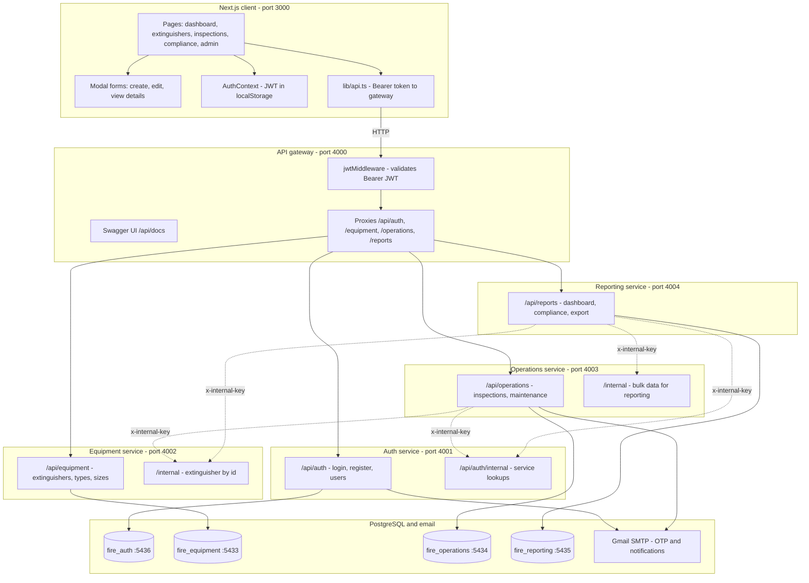

# TZW Fire Safety — System architecture

High-level view of how the React client, API gateway, microservices, and data stores connect.

## Request flow (authenticated)

1. User logs in via `POST /api/auth/login` → receives `accessToken` and `refreshToken`.
2. Client stores tokens and sends `Authorization: Bearer …` on every API call to port **4000**.
3. Gateway validates JWT and forwards `x-user-id`, `x-user-role`, `x-user-email` to downstream services.
4. Each service enforces role rules (e.g. ADMIN-only delete, INSPECTOR can schedule inspections).

## Public routes (no JWT at gateway)

Registration, login, refresh, and password-reset endpoints under `/api/auth` (see OpenAPI).
